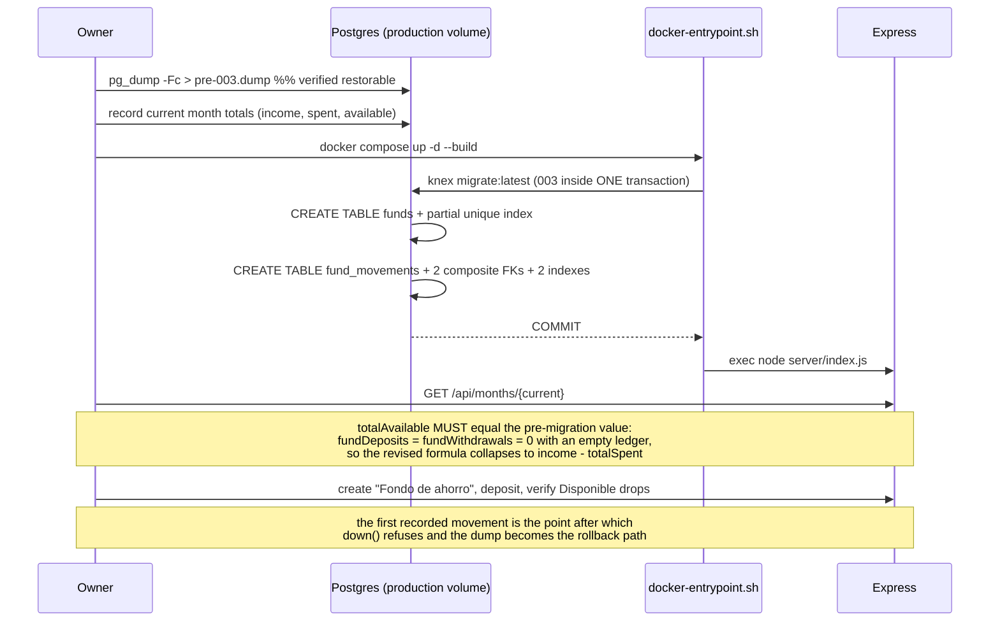

# Design: Savings and Investment Funds

> **Size note**: this document exceeds the generic SDD design word budget on purpose. `openspec/config.yaml` → `rules.design` requires sequence diagrams and documented rationale, and this is a persistence-boundary change whose house precedent is `openspec/changes/archive/2026-09-11-multiple-budgets/design.md`. Concrete DDL and exact query rewrites are the artifact's value here, not prose.

## Technical Approach

Two new tables — `funds` (identity only) and `fund_movements` (an append-only ledger) — are added in `server/migrations/003_savings_investment_funds.js`. A fund's balance is `SUM(deposits) − SUM(withdrawals)` computed at read time and never stored, so `tests/contract/invariant.test.js`'s Derived-Balance Invariant holds by construction rather than by discipline.

Profile isolation reuses the exact `002_budget_profiles.js` shape: `funds.id` stays the global PK (a client-generated `fnd_xxxxxxxx`, like `categories.id`), and `UNIQUE (profile_id, id)` exists purely as a composite FK target so `fund_movements` references `funds(profile_id, id)`. A cross-profile movement becomes a constraint violation, not a missed `WHERE`.

`fund_movements` also carries `month_key`, derived server-side from the movement's own `date` via `monthKeyFromDate()` (Bug Fix B), with a composite FK to `months(profile_id, month_key)`. That makes the month-scoped aggregate a plain indexed row read with no join, and it means a movement physically cannot exist in an unmaterialized month.

`getMonthPayload()` gains **one** query (this month's movement rows) and reduces it in JS into two gross terms. `totals` becomes `{ income, totalBudgeted, totalSpent, fundDeposits, fundWithdrawals, totalAvailable }` with `totalAvailable = income − totalSpent − fundDeposits + fundWithdrawals`. The same rows ship in the payload as `fundMovements`, so `src/state.js: getMonthTotals()` runs the *identical* reduce over cached rows — parity becomes a tautology instead of a coincidence.

Implements `specs/savings-funds`; modifies `specs/budget-persistence`, `specs/budget-api`, `specs/budget-profiles`.

---

## Architecture Decisions

### Decision: `totals` gains two gross terms (`fundDeposits`, `fundWithdrawals`); `totalAvailable` keeps its name

**Choice**:

```js
totals: {
  income: income.amount,
  totalBudgeted,
  totalSpent,
  fundDeposits,      // non-negative gross sum of this month's deposits
  fundWithdrawals,   // non-negative gross sum of this month's withdrawals
  totalAvailable: income.amount - totalSpent - fundDeposits + fundWithdrawals,
}
```

| Option | Concrete cost in *this* codebase | Decision |
|---|---|---|
| Single net field (`netFundFlow`, or `fundMovementsNet`) | The sign convention is unreadable at the call site: `totalAvailable: income - totalSpent - netFundFlow` is correct only if the field is deposit-positive, and `+ netFundFlow` only if it is withdrawal-positive. Worse, `renderSummary()` must show "a fondos" and "desde fondos" separately (the user's two distinct actions), which a net number cannot produce — it would need a second derivation over `fundMovements` anyway, so the net field saves nothing and adds a sign trap. | Rejected |
| Rename `totalAvailable` (e.g. `spendableThisMonth`) | `totalAvailable` is read in exactly two places — `src/render.js:43,71` under the label "Disponible" — and both already mean *money you can still spend this month*, which is precisely what the new formula computes. The new terms refine the number, not its meaning. A rename also touches `tests/contract/parity.test.js` and every month-payload contract test for zero semantic gain, and `total_available` is already pinned in `FORBIDDEN_COLUMN_NAMES`, so the name carries invariant meaning worth keeping. | Rejected |
| **Two gross non-negative terms, `totalAvailable` unchanged** | `totals` grows from 4 keys to 6. `parity.test.js:96,113,166` compares the whole object with `toEqual`, so the client must change in lockstep — which is the point, not the cost. | **Chosen** |

**Rationale**: the two gross names mirror the existing `totalSpent` / `totalBudgeted` convention (one non-negative gross term per concept, composition left to the formula), they are directly renderable, and each is independently assertable in a contract test. A deposit of 200 and a withdrawal of 200 in the same month must be distinguishable from no activity at all — the user did two real things — and only gross terms preserve that.

These are JSON response fields, not columns. `balance`, `fundDeposits`, and `fundWithdrawals` exist nowhere in the schema, which is exactly why adding `balance` to `FORBIDDEN_COLUMN_NAMES` (below) is both safe and meaningful.

### Decision: one row query reduced in JS, not a second SQL aggregate

**Choice**: `getMonthPayload()` selects this month's `fund_movements` rows once and reduces them in JavaScript. No `GROUP BY type` aggregate is issued.

**Alternatives considered**: a `SUM(...) FILTER (WHERE type = ...)` aggregate alongside the row select; an aggregate only, with no rows in the payload.

**Rationale**: the per-category aggregate at `server/services/months.js:121-138` is SQL because it must `LEFT JOIN` budgets to emit a row for **every** category, including ones with neither budget nor spend. Fund movements need no outer join — the two totals are a plain sum over rows the payload must carry regardless. Issuing both a row select and an aggregate would be two round trips for a number already in hand, and it would create a drift surface where the SQL sum and the shipped rows could disagree.

Aggregate-only is worse: without `fundMovements` in the payload the client cannot re-derive `totalAvailable`, so `getMonthTotals()` would have to trust a server number while every sibling total is re-derived. That breaks the codebase's one parity guarantee (`tests/contract/parity.test.js`) at exactly the field most likely to drift.

### Decision: `type TEXT CHECK (type IN ('deposit','withdrawal'))` plus `CHECK (amount > 0)`

**Choice**: a discriminator column with a `CHECK` constraint, and a strictly positive amount.

| Option | Cost | Decision |
|---|---|---|
| Signed `amount`, no `type` | Recovering the two gross terms requires `WHERE amount > 0` / `< 0`, so sign *is* the type — but then `type` cannot be rendered, filtered, or indexed as a domain value, and a zero-amount row is semantically undefined. The UI renders the literal words "Depósito"/"Retiro"; deriving them from a sign in the view layer puts domain meaning in `render.js`, which this codebase keeps out of presentation by convention. | Rejected |
| Postgres `ENUM` type | Needs its own `CREATE TYPE` / `DROP TYPE` in `up()`/`down()`, has no first-class Knex schema-builder support, and adding a third movement kind later means `ALTER TYPE`. No existing migration in this repo creates a type. | Rejected |
| **`TEXT` + `CHECK IN`** | One line in the migration, matches the three existing `table.check(...)` uses (`001_init.js:21,37,46`, `002:51`). | **Chosen** |

**Why a `CHECK` on `amount` here when `transactions` deliberately has none**: `001_init.js:54-55` is explicit that the omission exists so the one-time legacy localStorage import stays lossless — a pre-existing corrupt row must be importable. `fund_movements` has **no legacy corpus**; the proposal states there are zero rows to backfill, and `server/routes/import.js` will not write to it. The escape hatch has nothing to protect, so the stricter constraint is free, and `amount > 0` plus the type enum makes the aggregate's sign semantics a schema guarantee rather than an API-layer convention.

### Decision: the ledger is append-only — no movement edit or delete in this change

**Choice**: `POST /api/funds/{id}/movements` is the only write to `fund_movements`. There is no `PUT` and no `DELETE`. A mistake is corrected by recording the opposite movement.

**Alternatives considered**: mirroring `transactions`' full `POST`/`PUT`/`DELETE` surface.

**Rationale**: a fund movement is the *only* record that money moved into or out of a fund — unlike a transaction, nothing else in the schema witnesses it (no carry-forward copy, no category aggregate). Editing one silently rewrites a closed month's `totalAvailable`, which is the proposal's "a withdrawal inflates available money retroactively in a closed month" risk made routine. Deleting a deposit from three months ago would change that month's Disponible with no audit trail of the change. A compensating movement keeps every month's historical total stable and leaves both facts visible in the per-fund history. It also keeps the change inside the 400-line review budget. Editing can be added later additively; un-shipping a destructive endpoint cannot.

### Decision: archiving a fund with a nonzero balance is refused with `409 fund_has_balance`

**Choice**: `DELETE /api/funds/{id}` archives (never row-deletes), with two guards inside one transaction, modeled on `archiveProfile` (`server/services/profiles.js:68-87`):

```js
export async function archiveFund(profileId, id) {
  await db.transaction(async (trx) => {
    // forUpdate() on the fund row is what serializes this check against a
    // concurrent movement insert, which takes the SAME row lock (below).
    // A SUM cannot be locked; the fund row it sums over can.
    const fund = await trx('funds').where({ id, profile_id: profileId }).forUpdate().first();
    if (!fund) throw notFound(`Fund ${id} not found`);

    const balance = await computeFundBalance(trx, profileId, id);
    if (balance !== 0) {
      throw conflict(
        `Este fondo todavía tiene saldo (${balance}). Retira el saldo completo antes de archivarlo.`,
        'fund_has_balance'
      );
    }
    await trx('funds').where({ id, profile_id: profileId }).update({ archived: true });
  });
}
```

Every movement write takes the same `forUpdate()` lock on its fund row and rejects an archived fund with `409 fund_archived`. The two paths therefore serialize on one row, so "archived ⇒ balance is zero and stays zero" holds under concurrency.

**Alternatives considered**: allow the archive and keep history readable (the `categories.archived` rule); block only in the UI.

**Rationale**: archiving a category hides a *label for future spending*; its history stays visible and its money was already spent. A fund balance is **money that currently exists**. Because the confirmed requirements forbid any carry-forward or reset of a fund balance, an archived nonzero fund is money that never resurfaces — permanently invisible, with no archived-fund view in scope to recover it. The exit is explicit and matches reality: withdraw the balance to zero first, which also correctly increases that month's available money because the money genuinely came back. A UI-only block is not a rule; it is a suggestion the API would contradict.

### Decision: withdrawing more than the balance is refused with `409 insufficient_funds`

**Choice**: a withdrawal is validated against the balance computed inside the same `forUpdate()` transaction that inserts it.

**Alternatives considered**: allow a negative balance, as a category legitimately goes over budget.

**Rationale**: a category budget is an *intent*, so exceeding it is meaningful information (`parity.test.js:93` asserts `remaining === -300` on purpose). A fund balance is a *quantity of money*; a negative one is not an over-budget signal, it is a falsehood that silently inflates `totalAvailable` by money that never existed. The lock already needed for the archive guard makes the check free.

### Decision: `funds` (with balance) ship in `buildBootstrapPayload`; this month's movements ship in the month payload

**Choice**: `buildBootstrapPayload()` gains `funds: [{ id, name, archived, createdAt, balance }]`. `getMonthPayload()` gains `fundMovements: [...]`. Per-fund full history stays a lazy `GET /api/funds/{id}/movements`.

| Option | Cost | Decision |
|---|---|---|
| Balance in the month payload | A balance is an **all-time** aggregate; a month payload is re-fetched on every arrow click in `setActiveMonth()`. The same unchanging number would be recomputed and re-sent per navigation, and — worse — it would *look* month-scoped to the client, inviting exactly the "fund balance resets monthly" bug the confirmed requirements forbid. | Rejected |
| Lazy `GET /api/funds` on load | `setActiveProfile()` replaces the whole cache from **one** payload (`src/state.js:196-203`) specifically so a half-swapped state is unrepresentable. A separate funds fetch reopens that window: the funds section would render the previous profile's funds until the second request lands — the precise failure `PUT /api/profiles/active` was designed to prevent. | Rejected |
| Full movement history in bootstrap | Unbounded growth in the hot-path payload for data only one overlay shows. | Rejected |
| **Funds+balance in bootstrap, month movements in the month payload, history lazy** | `buildBootstrapPayload` gains one aggregate query; `getMonthPayload` gains one row query. | **Chosen** |

**Rationale**: funds are profile-scoped identity, exactly like `categories` — the same list the UI must paint on first render and must swap atomically on a profile switch. Movements-this-month are month-scoped, exactly like `transactions`, and are required in the month payload for client re-derivation. Each datum lands in the payload whose lifecycle actually matches it.

### Decision: the client caches the server-computed balance and does **not** re-derive it

**Choice**: `cache.funds[i].balance` is a server-supplied number, refreshed from the `POST .../movements` response. `getMonthTotals()` re-derives the `totals` fund terms from `cache.months[k].fundMovements`.

**Rationale**: the client cache is month-scoped by construction (`cache.months[monthKey]`), so an all-time aggregate is **not derivable client-side** — it would require every month ever recorded. The derived-balance invariant is about *persistence* ("no stored column"), and it holds: the balance is computed at read time from the ledger on every request. The split is deliberate and testable: `totals` is re-derived and parity-asserted; `balance` is transported and asserted against a direct SQL sum in a contract test instead.

### Decision: the summary progress bar switches to fund-aware numerator and denominator

**Choice**: in `renderSummary()`, `pctUsed` and `status` are computed from `totalSpent + fundDeposits` against `income + fundWithdrawals`, not from `totalSpent` against `income`.

**Rationale**: leaving `src/render.js:45-46` untouched produces a visible contradiction — a user who deposits their whole income into a fund sees "Disponible $0.00" above a progress bar at 0% in `ok` green. The bar and the number must describe the same money or the summary card lies. This is one expression change in the one place both values are already in scope.

---

## Data Flow

```
                    settings.active_profile  (unchanged, server-resolved)
                                │
main.js ──▶ state.js ──fetch──▶ requireActiveProfile ──▶ req.profileId
   │                                      │
   │                         routes/funds.js  (new, mounted scoped)
   │                                      │
   │                     ┌────────────────┴────────────────┐
   │                     ▼                                 ▼
   │          services/funds.js                   services/months.js
   │          computeFundBalance()                getMonthPayload()
   │          listFundsWithBalance()              + fund_movements rows
   │                     │                                 │
   │                     ▼                                 ▼
   │              Postgres — funds / fund_movements, composite FKs:
   │              (profile_id, fund_id) and (profile_id, month_key)
   │              make a cross-profile or orphan-month movement
   │              UNREPRESENTABLE
   │
   │  ◀── bootstrap: { settings, profiles, categories, funds, month }
   │      month:    { ..., fundMovements[], totals{ +fundDeposits, +fundWithdrawals } }
   ▼
render.js  renderFunds()  +  renderSummary() (fund-aware)
```

No payload leaks `profile_id`, consistent with the existing contract. `fundMovements` entries expose `fundId`, which the client needs to group this month's activity per fund card.

---

## Target Schema (resulting DDL)

```sql
-- Identity ONLY. No amount column of any kind lives here — the balance is
-- SUM(deposits) - SUM(withdrawals) at read time (budget-persistence spec,
-- "Derived-Balance Invariant").
CREATE TABLE funds (
  id         TEXT PRIMARY KEY,                         -- client-generated 'fnd_xxxxxxxx'
  profile_id TEXT NOT NULL REFERENCES budget_profiles(id) ON DELETE RESTRICT,
  name       TEXT NOT NULL CHECK (length(btrim(name)) > 0),
  archived   BOOLEAN NOT NULL DEFAULT FALSE,
  created_at TIMESTAMPTZ NOT NULL DEFAULT now(),
  CONSTRAINT funds_profile_id_unique UNIQUE (profile_id, id)   -- composite FK target
);

CREATE INDEX funds_profile_idx ON funds (profile_id, created_at);

-- Case-insensitive name uniqueness among LIVE funds of the SAME profile, so
-- an archived "Fondo de ahorro" does not block a new one, and two profiles
-- may each have a fund of the same name. Mirrors
-- budget_profiles_live_name_unique (002_budget_profiles.js:55-58).
CREATE UNIQUE INDEX funds_live_name_unique
  ON funds (profile_id, lower(btrim(name))) WHERE archived = FALSE;

-- Append-only ledger. month_key is derived server-side from `date`, never
-- supplied by the client (Bug Fix B).
CREATE TABLE fund_movements (
  id         TEXT PRIMARY KEY,                         -- 'fmv_xxxxxxxx'
  profile_id TEXT NOT NULL,
  fund_id    TEXT NOT NULL,
  month_key  TEXT NOT NULL,
  type       TEXT NOT NULL CHECK (type IN ('deposit', 'withdrawal')),
  -- Unlike transactions.amount (which has no CHECK, so the one-time legacy
  -- import stays lossless), this table has NO legacy corpus — so the
  -- constraint is free and makes the aggregate's sign a schema guarantee.
  amount     NUMERIC(14,2) NOT NULL CHECK (amount > 0),
  note       TEXT NOT NULL DEFAULT '',
  date       TIMESTAMPTZ NOT NULL,
  created_at TIMESTAMPTZ NOT NULL DEFAULT now(),
  FOREIGN KEY (profile_id, fund_id)   REFERENCES funds(profile_id, id)          ON DELETE RESTRICT,
  FOREIGN KEY (profile_id, month_key) REFERENCES months(profile_id, month_key)  ON DELETE RESTRICT
);

-- Serves getMonthPayload()'s month-scoped read directly.
CREATE INDEX fund_movements_profile_month_idx ON fund_movements (profile_id, month_key);
-- Serves computeFundBalance() and the per-fund history list (date DESC).
CREATE INDEX fund_movements_fund_idx ON fund_movements (profile_id, fund_id, date DESC);
```

**Derived-balance invariant holds**: neither table has a `balance`, `spent`, `remaining`, `available`, or `total_*` column. `amount` on an individual ledger row is an input fact, not a derived aggregate — the same status `transactions.amount` and `months.income_amount` already have.

### FK graph after `003`

```
budget_profiles
  ▲    ▲    ▲
  │    │    └──────────────── funds
  │    │                        ▲  (profile_id, id)
categories ◀── category_budgets │
  ▲              │              │
  │              ▼              │
  │           months ◀──────────┼──(profile_id, month_key)── fund_movements
  │              ▲              └──(profile_id, fund_id) ────────┘
transactions ────┘
```

`fund_movements` is the first table to hold **two** composite FKs into two different parents sharing the same leading `profile_id` column. That is what makes "a movement in profile A against a fund in profile B" and "a movement in a month that does not exist" both unrepresentable, with no handler cooperation required.

---

## Migration `server/migrations/003_savings_investment_funds.js`

Naming follows the two existing files exactly: zero-padded three-digit ordinal + snake_case change name. Knex resolves migration order lexicographically on filename, so the `003` prefix is load-bearing.

Unlike `002`, this migration **adds no column to any existing table and backfills nothing** — so it needs no row-count assertions, no nullable-then-NOT-NULL dance, and no `settings` seed. Knex's default per-migration transaction plus Postgres transactional DDL still make it atomic; the migration MUST NOT set `disableTransactions` and MUST NOT open a nested transaction.

```js
export async function up(knex) {
  // 1 — identity table first (fund_movements references it)
  await knex.schema.createTable('funds', (t) => {
    t.text('id').primary();
    t.text('profile_id').notNullable().references('id').inTable('budget_profiles').onDelete('RESTRICT');
    t.text('name').notNullable();
    t.check('length(btrim(name)) > 0', [], 'funds_name_not_blank');
    t.boolean('archived').notNullable().defaultTo(false);
    t.timestamp('created_at', { useTz: true }).notNullable().defaultTo(knex.fn.now());
    t.unique(['profile_id', 'id'], { indexName: 'funds_profile_id_unique' });  // composite FK target
    t.index(['profile_id', 'created_at'], 'funds_profile_idx');
  });
  await knex.raw(
    `CREATE UNIQUE INDEX funds_live_name_unique
       ON funds (profile_id, lower(btrim(name))) WHERE archived = FALSE`
  );

  // 2 — the ledger
  await knex.schema.createTable('fund_movements', (t) => {
    t.text('id').primary();
    t.text('profile_id').notNullable();
    t.text('fund_id').notNullable();
    t.text('month_key').notNullable();
    t.text('type').notNullable();
    t.check("type IN ('deposit', 'withdrawal')", [], 'fund_movements_type_valid');
    t.decimal('amount', 14, 2).notNullable();
    t.check('amount > 0', [], 'fund_movements_amount_positive');
    t.text('note').notNullable().defaultTo('');
    t.timestamp('date', { useTz: true }).notNullable();
    t.timestamp('created_at', { useTz: true }).notNullable().defaultTo(knex.fn.now());
    t.foreign(['profile_id', 'fund_id']).references(['profile_id', 'id']).inTable('funds').onDelete('RESTRICT');
    t.foreign(['profile_id', 'month_key']).references(['profile_id', 'month_key']).inTable('months').onDelete('RESTRICT');
    t.index(['profile_id', 'month_key'], 'fund_movements_profile_month_idx');
    t.index(['profile_id', 'fund_id', 'date'], 'fund_movements_fund_idx');
  });
}
```

### `down()` — refuses once any movement exists

```js
export async function down(knex) {
  // A fund movement is the ONLY record that money entered or left a fund.
  // Nothing else in the schema witnesses it: there is no carry-forward copy
  // and no mirror in `transactions`. Dropping the ledger is unrecoverable, so
  // down() refuses rather than destroying it silently — the same stance 002
  // took against silently merging isolated budgets. The pre-migration
  // pg_dump is the recovery path past that point (proposal.md "Rollback Plan").
  const [{ count }] = await knex('fund_movements').count({ count: '*' });
  if (Number(count) > 0) {
    throw new Error(
      `003 down(): ${count} fund movements exist. Rolling back would destroy the only ` +
        `record of money held in or withdrawn from a fund. Restore the pre-migration pg_dump instead.`
    );
  }
  await knex.schema.dropTable('fund_movements');   // reverse creation order
  await knex.schema.dropTable('funds');            // its indexes drop with it
}
```

An **empty-ledger** `down()` is a clean, lossless return to the exact `002` shape — which is the only rollback window that matters: a bad deploy caught before the owner records a movement. Fund *names* with no movements are deliberately not protected; a name is retypable, money is not.

---

## Query Rewrites

### New: `server/services/funds.js`

One builder shared by `server/routes/funds.js` and `server/services/bootstrap.js`, so both call sites stay in shape by construction — the same lesson as `SETTINGS_KEYS` and `buildBootstrapPayload`.

```js
// Mirrors getMonthPayload()'s per-category aggregate exactly: LEFT JOIN so a
// fund with zero movements still yields a row (balance 0), plus the
// defense-in-depth `m.profile_id = f.profile_id` join predicate — logically
// redundant given the composite FK, free on the same index, and leak-proof
// even if a future migration relaxes the constraint.
export async function listFundsWithBalance(executor, profileId, { includeArchived = false } = {}) {
  const { rows } = await executor.raw(
    `SELECT f.id, f.name, f.archived, f.created_at,
            COALESCE(SUM(CASE WHEN m.type = 'deposit'    THEN m.amount ELSE 0 END), 0)
          - COALESCE(SUM(CASE WHEN m.type = 'withdrawal' THEN m.amount ELSE 0 END), 0) AS balance
     FROM funds f
     LEFT JOIN fund_movements m
            ON m.fund_id    = f.id
           AND m.profile_id = f.profile_id
     WHERE f.profile_id = ?
       AND (? OR f.archived = FALSE)
     GROUP BY f.id, f.name, f.archived, f.created_at
     ORDER BY f.created_at ASC`,
    [profileId, includeArchived]
  );
  return rows.map(serializeFund);
}

// Single-fund balance for the archive and insufficient-funds guards. MUST be
// called with the trx that already holds forUpdate() on the funds row.
export async function computeFundBalance(executor, profileId, fundId) {
  const { rows } = await executor.raw(
    `SELECT COALESCE(SUM(CASE WHEN type = 'deposit'    THEN amount ELSE 0 END), 0)
          - COALESCE(SUM(CASE WHEN type = 'withdrawal' THEN amount ELSE 0 END), 0) AS balance
     FROM fund_movements WHERE profile_id = ? AND fund_id = ?`,
    [profileId, fundId]
  );
  return Number(rows[0].balance);
}

export function serializeFund(row) {
  return {
    id: row.id,
    name: row.name,
    archived: row.archived,
    createdAt: row.created_at instanceof Date ? row.created_at.toISOString() : row.created_at,
    balance: Number(row.balance),
  };
}

export function serializeFundMovement(row) {
  return {
    id: row.id,
    fundId: row.fund_id,
    type: row.type,
    amount: Number(row.amount),
    note: row.note,
    date: row.date instanceof Date ? row.date.toISOString() : row.date,
    monthKey: row.month_key,
  };
}
```

### `getMonthPayload()` — `server/services/months.js:95-189`

One query is **added** (after the transactions read at `:105-110`, before the category aggregate), and the `totals` literal at `:177-182` changes. Nothing else in the function moves.

```js
  // This month's fund movements. Scoped by (profile_id, month_key), which is
  // exactly the leading edge of fund_movements_profile_month_idx. Ordered like
  // transactions (date DESC, id DESC) so the client can render without sorting.
  const fundMovementRows = await executor('fund_movements')
    .where({ profile_id: profileId, month_key: monthKey })
    .orderBy([
      { column: 'date', order: 'desc' },
      { column: 'id', order: 'desc' },
    ]);
  const fundMovements = fundMovementRows.map((row) => ({
    id: row.id,
    fundId: row.fund_id,
    type: row.type,
    amount: Number(row.amount),
    note: row.note,
    date: row.date instanceof Date ? row.date.toISOString() : row.date,
  }));

  // The SAME reduce src/state.js:getMonthTotals() runs over the SAME rows.
  // Parity is then structural, not a coincidence that a test happens to catch.
  let fundDeposits = 0;
  let fundWithdrawals = 0;
  for (const movement of fundMovements) {
    if (movement.type === 'deposit') fundDeposits += movement.amount;
    else fundWithdrawals += movement.amount;
  }
```

```js
  return {
    monthKey,
    materialized,
    income,
    budgets,
    transactions,
    fundMovements,                                      // NEW
    totals: {
      income: income.amount,
      totalBudgeted,
      totalSpent,
      fundDeposits,                                     // NEW
      fundWithdrawals,                                  // NEW
      totalAvailable: income.amount - totalSpent - fundDeposits + fundWithdrawals,
    },
    categoryTotals,
    carryForward: { /* unchanged */ },
  };
```

`fundMovements` entries deliberately omit `monthKey` (it equals the payload's own `monthKey`), matching how `transactions` entries omit it at `:111-117` while the `POST` response at `routes/transactions.js:17-26` includes it — the client needs it only to pick a cache bucket after a write.

### `buildBootstrapPayload()` — `server/services/bootstrap.js:31-53`

`funds` joins the existing `Promise.all`, so bootstrap gains no round trip:

```js
  const [categoryRows, profileRows, funds] = await Promise.all([
    activeProfileId
      ? executor('categories').where({ profile_id: activeProfileId }).orderBy('created_at', 'asc')
      : Promise.resolve([]),
    executor('budget_profiles').where({ archived: false }).orderBy('created_at', 'asc'),
    activeProfileId ? listFundsWithBalance(executor, activeProfileId) : Promise.resolve([]),
  ]);
  // ...
  return { settings, profiles, categories: categoryRows.map(serializeCategory), funds, month };
```

Because this is the shared builder, `GET /api/bootstrap` **and** `PUT /api/profiles/active` both gain `funds` in one edit — the profile switch keeps returning one atomically-consistent payload.

---

## API Contract

All responses JSON; errors keep the existing `{ error: { code, message, field? } }` shape.

### New: `server/routes/funds.js`

Mounted in `server/routes/index.js` alongside the other scoped routers:

```js
router.use('/funds', requireActiveProfile, fundsRouter);
```

| Method | Path | Request | Response |
|---|---|---|---|
| GET | `/api/funds` | `?includeArchived=1` optional | `[{ id, name, archived, createdAt, balance }]`, `created_at ASC` |
| POST | `/api/funds` | `{ id?, name }` | `201` fund with `balance: 0`; `400` blank name; `409 duplicate_name` |
| PATCH | `/api/funds/{id}` | `{ name }` | fund; `404` unknown **or foreign** id; `409 duplicate_name` |
| DELETE | `/api/funds/{id}` | — | `204`; `404`; `409 fund_has_balance` |
| GET | `/api/funds/{id}/movements` | `?limit=` (default 50, max 200) | `[{ id, fundId, type, amount, note, date, monthKey }]`, `date DESC, id DESC`; `404` |
| POST | `/api/funds/{id}/movements` | `{ id?, type, amount, note?, date? }` | `201 { movement, balance }`; `400`; `404`; `409 fund_archived`; `409 insufficient_funds` |

**One movement endpoint, not `/deposit` + `/withdraw`**: the sequence is byte-identical for both types — resolve and `forUpdate()`-lock the fund, reject if archived, parse the date, derive `month_key`, `materializeMonth`, check the balance for a withdrawal, insert, recompute the balance. Duplicating that across two handlers is the exact duplicated-logic bug class this repo already paid for with the hardcoded settings whitelist (`SETTINGS_KEYS`). An invalid `type` is a loud `400`.

**A foreign id returns `404`, never `403`**: every lookup carries `profile_id: req.profileId`, so a fund belonging to another profile is indistinguishable from one that does not exist — the rule `server/routes/categories.js:78-83` already states.

### Changed shapes

| Endpoint | Change |
|---|---|
| `GET /api/bootstrap` | `+ funds: [...]` (each with `balance`) |
| `PUT /api/profiles/active` | `+ funds: [...]` — same shared builder, scoped to the newly activated profile |
| `GET /api/months/{k}` | `+ fundMovements: [...]`; `totals` `+ fundDeposits`, `+ fundWithdrawals`; `totals.totalAvailable` semantics revised |
| `POST /api/months/{k}/carry-forward` | Shape unchanged. It copies **no** fund value — a fund balance never carries forward (confirmed requirement) |
| `POST /api/import/legacy` | Unchanged. Writes nothing to `funds`/`fund_movements`; legacy localStorage has no fund concept |

---

## Sequence: Deposit and Withdrawal

```mermaid
sequenceDiagram
    participant U as User (fund card)
    participant M as main.js
    participant S as state.js
    participant API as POST /api/funds/{id}/movements
    participant DB as Postgres

    U->>M: click "Depositar" on fund fnd_ahorro
    M->>M: openFundMovementFormFor('fnd_ahorro', 'deposit')
    U->>M: submit { type:'deposit', amount:200, date:'2026-10-08' }
    M->>S: addFundMovement('fnd_ahorro', payload)   %% wrapped in withBusy()
    S->>API: { type:'deposit', amount:200, date:'2026-10-08' }

    API->>API: startOfDayInTz('2026-10-08') -> Date
    API->>API: monthKeyFromDate(date) -> '2026-10'   %% NEVER from the client
    API->>DB: BEGIN
    API->>DB: SELECT * FROM funds WHERE id=? AND profile_id=? FOR UPDATE
    DB-->>API: row   (404 if missing/foreign; 409 fund_archived if archived)
    Note over API,DB: withdrawal only: computeFundBalance() under the same lock<br/>balance < amount => 409 insufficient_funds, nothing written
    API->>DB: materializeMonth(trx, profileId, '2026-10')
    Note over API,DB: REQUIRED — the composite FK to months(profile_id, month_key)<br/>rejects the insert otherwise (loud, not silent)
    API->>DB: INSERT INTO fund_movements (..., type, amount, month_key)
    API->>DB: computeFundBalance() -> new balance
    API->>DB: COMMIT
    API-->>S: 201 { movement: { ..., monthKey:'2026-10' }, balance: 1450 }

    S->>S: cache.funds[i].balance = payload.balance        %% no refetch
    S->>S: ensureCacheMonth(movement.monthKey)             %% server's month, not the viewed one
    S->>S: month.fundMovements.unshift(movement)
    M->>M: renderApp()
    Note over M: renderFunds() shows the new balance;<br/>renderSummary() shows Disponible down by 200<br/>(a withdrawal would show it UP by the amount)
```

The write and the balance read share one transaction, so the returned `balance` can never describe a state the ledger does not have. On any rejection `state.js` throws before touching the cache and `withBusy()` (`src/main.js:68-86`) renders the error banner — the old balance stays on screen and stays correct.

Note the deliberate asymmetry with `monthKey`: the client passes no month at all. A movement dated last month lands in last month's bucket and changes **that** month's `totalAvailable`, which is why `created.monthKey` — not the month on screen — selects the cache bucket, exactly as `addTransaction` already does (`src/state.js:205-223`).

## Sequence: Archiving a fund (the `409 fund_has_balance` guard)

```mermaid
sequenceDiagram
    participant U as User
    participant S as state.js
    participant API as DELETE /api/funds/{id}
    participant DB as Postgres

    U->>S: confirm "¿Archivar este fondo?"
    S->>API: DELETE /api/funds/fnd_ahorro
    API->>DB: BEGIN
    API->>DB: SELECT * FROM funds WHERE id=? AND profile_id=? FOR UPDATE
    Note over API,DB: the row lock is what serializes this against a concurrent<br/>movement insert, which takes the SAME lock. A SUM cannot be<br/>locked; the fund row it sums over can.
    API->>DB: computeFundBalance(trx, profileId, fundId)
    alt balance != 0
        DB-->>API: 1450
        API->>DB: ROLLBACK
        API-->>S: 409 fund_has_balance
        S-->>U: error banner: "Retira el saldo completo antes de archivarlo."
        Note over U,S: cache untouched — the fund stays live and visible
    else balance == 0
        DB-->>API: 0
        API->>DB: UPDATE funds SET archived = TRUE
        API->>DB: COMMIT
        API-->>S: 204
        S->>S: cache.funds[i].archived = true
        S-->>U: fund disappears from #fundsList; its movement history is intact
    end
```

A movement insert that arrives between the balance read and the `UPDATE` blocks on the same row lock, so it commits strictly before or strictly after — "archived implies balance zero" cannot be violated by interleaving.

## Sequence: Production Migration



`003` adds no column and backfills nothing, so a failed migration leaves the `002` shape bit-identical and `set -e` stops Express from binding against a half-migrated database.

---

## Client Changes

### `index.html`

A new section between `#summaryCard` (`:27`) and `.categories-section` (`:29`) — funds sit above categories because a deposit decision precedes category spending:

```html
<section class="funds-section">
  <div class="section-header">
    <h2>Fondos</h2>
    <button id="addFundBtn" class="btn-link">+ Nuevo</button>
  </div>
  <div id="fundsList" class="funds-list"></div>
</section>
```

Two new overlays, structured exactly like `#categoryFormOverlay` / `#profileFormOverlay` so the existing `closeAllOverlays()` and `[data-close]` wiring (`src/main.js:25-38`) picks them up with **no changes**:

```html
<!-- Formulario: fondo (crear/editar/archivar) -->
<div id="fundFormOverlay" class="overlay" hidden>
  <form id="fundForm" class="sheet">
    <h2 id="fundFormTitle">Nuevo fondo</h2>
    <input type="hidden" id="fundId">
    <label>Nombre
      <input type="text" id="fundName" maxlength="30" required placeholder="Ej. Fondo de ahorro">
    </label>
    <div class="sheet-actions">
      <button type="button" class="btn-danger" id="deleteFundBtn" hidden>Archivar</button>
      <button type="button" class="btn-secondary" data-close>Cancelar</button>
      <button type="submit" class="btn-primary">Guardar</button>
    </div>
  </form>
</div>

<!-- Formulario: movimiento (depósito/retiro) -->
<div id="fundMovementFormOverlay" class="overlay" hidden>
  <form id="fundMovementForm" class="sheet">
    <h2 id="fundMovementFormTitle">Depositar en el fondo</h2>
    <input type="hidden" id="movementFundId">
    <input type="hidden" id="movementType">
    <p class="summary-meta" id="movementBalanceHint"></p>
    <label>Monto
      <input type="number" id="movementAmount" step="0.01" min="0.01" required inputmode="decimal" placeholder="0.00">
    </label>
    <label>Fecha
      <input type="date" id="movementDate" required>
    </label>
    <label>Nota (opcional)
      <input type="text" id="movementNote" maxlength="80" placeholder="Ej. Ahorro de octubre">
    </label>
    <div class="sheet-actions">
      <button type="button" class="btn-secondary" data-close>Cancelar</button>
      <button type="submit" class="btn-primary">Guardar movimiento</button>
    </div>
  </form>
</div>
```

`#movementType` is a hidden input set by whichever button opened the overlay, not a `<select>`: the user already expressed intent by clicking "Depositar" or "Retirar", and a select would let them contradict the title they are reading.

### `src/api.js`

Six thin additions following the existing `request()` pattern:

```js
export function getFunds()                    { return request('/funds'); }
export function createFund(payload)           { return request('/funds', { method: 'POST', body: payload }); }
export function renameFund(id, name)          { return request(`/funds/${encodeURIComponent(id)}`, { method: 'PATCH', body: { name } }); }
export function archiveFund(id)               { return request(`/funds/${encodeURIComponent(id)}`, { method: 'DELETE' }); }
export function getFundMovements(id)          { return request(`/funds/${encodeURIComponent(id)}/movements`); }
export function createFundMovement(id, body)  { return request(`/funds/${encodeURIComponent(id)}/movements`, { method: 'POST', body }); }
```

### `src/storage.js`

`defaultData()` gains one field so the factory still describes the whole cache:

```js
    categories: [],
    months: {},
    profiles: [],
    funds: []            // lo llena el servidor en bootstrap(); `balance` viene derivado
```

Each cached month gains `fundMovements: []` in all three shape sites — `EMPTY_MONTH` (`src/state.js:20-26`), `ensureCacheMonth()` (`:36-47`), and `monthFromPayload()` (`:49-57`).

### `src/state.js`

```js
export function getFunds() {
  return cache.funds.filter(f => !f.archived);
}

// El saldo lo DERIVA el servidor (todo el histórico), porque el cache del
// cliente es por mes y no puede sumar meses que nunca cargó. No se almacena
// en ninguna columna: se recalcula en cada lectura.
export function getFundBalance(fundId) {
  const fund = cache.funds.find(f => f.id === fundId);
  return fund ? fund.balance : 0;
}

// Movimientos del mes visible, agrupados por fondo, para la tarjeta.
export function getFundMonthMovements(monthKey, fundId) {
  return readMonth(monthKey).fundMovements.filter(m => m.fundId === fundId);
}

export async function addFund(name) { /* api.createFund -> push into cache.funds */ }
export async function renameFund(id, name) { /* api.renameFund -> replace in place */ }

// No se borra físicamente: se archiva. El servidor RECHAZA (409
// fund_has_balance) archivar un fondo con saldo — ese dinero existe y no se
// arrastra al mes siguiente, así que quedaría invisible para siempre.
export async function archiveFund(id) {
  await api.archiveFund(id);
  const idx = cache.funds.findIndex(f => f.id === id);
  if (idx !== -1) cache.funds[idx] = { ...cache.funds[idx], archived: true };
}

// `monthKey` NO se envía: el servidor deriva el mes real del `date` del
// movimiento (Bug Fix B), igual que addTransaction. Por eso el movimiento
// puede caer en un mes distinto del que se ve en pantalla, y es al mes
// devuelto (`movement.monthKey`) al que se agrega en el cache.
export async function addFundMovement(fundId, { type, amount, note, date }) {
  const { movement, balance } = await api.createFundMovement(fundId, { type, amount, note, date });
  const idx = cache.funds.findIndex(f => f.id === fundId);
  if (idx !== -1) cache.funds[idx] = { ...cache.funds[idx], balance };
  const month = ensureCacheMonth(movement.monthKey);
  month.fundMovements.unshift({
    id: movement.id, fundId: movement.fundId, type: movement.type,
    amount: movement.amount, note: movement.note, date: movement.date
  });
  return movement;
}
```

`bootstrap()` (`:61-81`) gains `cache.funds = initial.funds.map(f => ({ ...f }));`.

`setActiveProfile()` (`:196-203`) **must** gain `cache.funds = payload.funds.map(f => ({ ...f }));`. Omitting it leaves the previous profile's funds — and their balances — rendered under the new profile. That is the same class of leak the full-`cache.months` reset exists to prevent, and it is the single highest-value review item on the client side.

`getMonthTotals()` (`:279-290`) becomes the exact mirror of the server reduce:

```js
export function getMonthTotals(monthKey) {
  const month = readMonth(monthKey);
  const income = month.income.amount;
  const totalBudgeted = Object.values(month.budgets).reduce((sum, v) => sum + v, 0);
  const totalSpent = month.transactions.reduce((sum, t) => sum + t.amount, 0);
  // `|| []` protege a un mes cacheado por una versión anterior del cliente:
  // una función pura de lectura nunca debe lanzar. NO sustituye al fixture —
  // ver el riesgo "paridad vacua" en la tabla de riesgos.
  const movements = month.fundMovements || [];
  const fundDeposits = movements.filter(m => m.type === 'deposit').reduce((s, m) => s + m.amount, 0);
  const fundWithdrawals = movements.filter(m => m.type === 'withdrawal').reduce((s, m) => s + m.amount, 0);
  return {
    income,
    totalBudgeted,
    totalSpent,
    fundDeposits,
    fundWithdrawals,
    totalAvailable: income - totalSpent - fundDeposits + fundWithdrawals
  };
}
```

### `src/render.js`

`renderApp()` (`:10-17`) gains one call, placed to match the DOM order:

```js
export function renderApp() {
  renderProfileSelect();
  renderMonthLabel();
  renderSummary();
  renderFunds();          // NEW — between summary and categories
  renderCategories();
  renderTransactions();
  renderCategorySelectOptions();
}
```

```js
function renderFunds() {
  const monthKey = getActiveMonth();
  const funds = getFunds();
  const currency = getData().settings.currency;
  const list = document.getElementById('fundsList');

  if (funds.length === 0) {
    list.innerHTML = `<p class="empty-state">Aún no tienes fondos. Toca "+ Nuevo" para crear uno (por ejemplo: Fondo de ahorro, Fondo de inversión).</p>`;
    return;
  }

  list.innerHTML = funds.map(fund => {
    const movements = getFundMonthMovements(monthKey, fund.id);
    const inThis  = movements.filter(m => m.type === 'deposit').reduce((s, m) => s + m.amount, 0);
    const outThis = movements.filter(m => m.type === 'withdrawal').reduce((s, m) => s + m.amount, 0);
    const monthMeta = (inThis || outThis)
      ? `<span>Este mes: +${formatCurrency(inThis, currency)} / −${formatCurrency(outThis, currency)}</span>`
      : `<span>Sin movimientos este mes</span>`;

    return `
      <div class="fund-card" data-id="${fund.id}">
        <div class="fund-header">
          <span class="fund-name">${fund.name}</span>
          <button class="btn-icon-sm edit-fund" data-id="${fund.id}" aria-label="Editar ${fund.name}">✎</button>
        </div>
        <div class="fund-balance">${formatCurrency(fund.balance, currency)}</div>
        <div class="fund-meta">${monthMeta}</div>
        <div class="fund-actions">
          <button class="btn-link fund-deposit"  data-id="${fund.id}">Depositar</button>
          <button class="btn-link fund-withdraw" data-id="${fund.id}" ${fund.balance <= 0 ? 'disabled' : ''}>Retirar</button>
        </div>
      </div>
    `;
  }).join('');
}
```

The disabled "Retirar" button is a UX hint only; `409 insufficient_funds` is the actual rule, because the client balance can be stale. `render.js` stays a pure synchronous reader — it gains read targets, not behavior.

`renderSummary()` (`:41-82`) changes in three places only:

```js
  const { income, totalBudgeted, totalSpent, fundDeposits, fundWithdrawals, totalAvailable } = getMonthTotals(monthKey);
  // El dinero que entra por retiros cuenta como disponible, y los depósitos
  // cuentan como salida: la barra y el número "Disponible" deben describir
  // el MISMO dinero, o la tarjeta se contradice (depositar todo el ingreso
  // mostraría $0 disponible sobre una barra verde al 0%).
  const outflow = totalSpent + fundDeposits;
  const inflow = income + fundWithdrawals;
  const pctUsed = inflow > 0 ? Math.min((outflow / inflow) * 100, 100) : (outflow > 0 ? 100 : 0);
  const status = budgetStatus(outflow, inflow);
```

plus one conditional row appended to `.summary-meta`:

```js
  const fundMeta = (fundDeposits || fundWithdrawals) ? `
    <div class="summary-meta">
      <span>A fondos: ${formatCurrency(fundDeposits, currency)}</span>
      <span>Desde fondos: ${formatCurrency(fundWithdrawals, currency)}</span>
    </div>
  ` : '';
```

### `src/main.js`

Delegated listeners on `#fundsList`, in the exact `e.target.closest(...)` shape of the `#categoriesList` (`:228-242`) and `#transactionsList` (`:313-337`) handlers:

```js
document.getElementById('addFundBtn').addEventListener('click', () => openFundFormFor(null));

document.getElementById('fundsList').addEventListener('click', (e) => {
  const editBtn = e.target.closest('.edit-fund');
  if (editBtn) {
    openFundFormFor(getData().funds.find(f => f.id === editBtn.dataset.id));
    return;
  }
  const moveBtn = e.target.closest('.fund-deposit, .fund-withdraw');
  if (!moveBtn) return;
  openFundMovementFormFor(moveBtn.dataset.id, moveBtn.classList.contains('fund-deposit') ? 'deposit' : 'withdrawal');
});

document.getElementById('fundMovementForm').addEventListener('submit', withBusy(
  submitButtonOf('fundMovementForm'),
  async (e) => {
    e.preventDefault();
    await addFundMovement(document.getElementById('movementFundId').value, {
      type:   document.getElementById('movementType').value,
      amount: document.getElementById('movementAmount').value,
      note:   document.getElementById('movementNote').value,
      date:   document.getElementById('movementDate').value
    });
    closeOverlay('fundMovementFormOverlay');
  }
));
```

Plus a `#fundForm` submit handler branching create/rename on the hidden `#fundId`, and `#deleteFundBtn` behind a `confirm()` inside `withBusy` — the same shape as `#deleteProfileBtn` (`:159-171`). `openFundMovementFormFor()` sets `#movementDate` from `toDateInputValue()` (`:94-100`) and fills `#movementBalanceHint` with `Saldo actual: ${formatCurrency(getFundBalance(id), currency)}`.

---

## File Changes

| File | Action | Description |
|---|---|---|
| `server/migrations/003_savings_investment_funds.js` | Create | `funds` + `fund_movements`, two composite FKs, partial unique name index, refusing `down()` |
| `server/services/funds.js` | Create | `listFundsWithBalance`, `computeFundBalance`, `archiveFund`, `serializeFund`, `serializeFundMovement` |
| `server/routes/funds.js` | Create | List / create / rename / archive / list movements / record movement |
| `server/services/months.js` | Modify | One added `fund_movements` query + JS reduce; `totals` gains 2 fields and a revised `totalAvailable`; payload gains `fundMovements` |
| `server/services/bootstrap.js` | Modify | `funds` joins the existing `Promise.all`; returned in the shared payload |
| `server/routes/index.js` | Modify | `router.use('/funds', requireActiveProfile, fundsRouter)` |
| `index.html` | Modify | `.funds-section` + `#fundFormOverlay` + `#fundMovementFormOverlay` |
| `src/api.js` | Modify | Six fund methods |
| `src/storage.js` | Modify | `defaultData()` gains `funds: []` |
| `src/state.js` | Modify | Fund readers/mutators; `fundMovements` in all three month shapes; `setActiveProfile` resets `cache.funds`; `getMonthTotals` gains the two fund terms |
| `src/render.js` | Modify | `renderFunds()`; fund-aware `renderSummary()` |
| `src/main.js` | Modify | `#addFundBtn`, `#fundsList` delegation, both new form handlers |
| `src/style.css` | Modify | `.funds-section`, `.fund-card`, `.fund-balance`, `.fund-actions` (reusing existing card/progress tokens) |
| `tests/contract/invariant.test.js` | Modify | **Exact update below** — forbidden-column list and pinned table list |
| `tests/contract/funds.test.js` | Create | Fund CRUD, movement recording, derived balance, both `409` guards |
| `tests/contract/months.test.js` | Modify | `totals` shape; deposit lowers / withdrawal raises `totalAvailable` by the exact amount |
| `tests/contract/isolation.test.js` | Modify | Funds and movements per-endpoint leakage matrix; DB-level composite-FK rejection |
| `tests/contract/parity.test.js` | Modify | Fixture gains `fundMovements`; assert the fund terms are nonzero |
| `tests/contract/migration.test.js` | Modify | `003` up/down; `down()` refuses with movements present |
| `tests/contract/health-bootstrap.test.js` | Modify | `funds` present in `GET /api/bootstrap` |
| `tests/unit/state.test.js` | Modify | `getMonthTotals` over a literal cache with fund movements |

---

## Exact `tests/contract/invariant.test.js` update

This is a correctness-critical test change, not an incidental one: without it, `003` fails the suite (the pinned table list) and a future stored balance would pass it unnoticed (the omitted column name).

**1 — `FORBIDDEN_COLUMN_NAMES` (`:11`)** gains the fund-balance vocabulary. The current list omits `balance`, so the invariant it claims to enforce would not have caught a `funds.balance` column at all:

```js
// `balance` and friends are added by the savings-investment-funds change: a
// fund balance is SUM(deposits) - SUM(withdrawals) at read time, never a
// column. The original list predated funds and omitted every name a stored
// fund balance would plausibly use, so the invariant was documented but not
// enforceable for this entity.
const FORBIDDEN_COLUMN_NAMES = [
  'spent',
  'remaining',
  'total_spent',
  'total_budgeted',
  'total_available',
  'available',
  'balance',
  'fund_balance',
  'total_deposited',
  'total_withdrawn',
];
```

No existing column in `001`/`002` uses any of these, so the first `it` stays GREEN after `003` with the two new tables in place. `funds.name`, `fund_movements.amount`, and `fund_movements.type` are inputs, not derived aggregates, and collide with nothing on the list.

**2 — the pinned table list (`:29-31`)** admits exactly the two new tables and nothing else:

```js
    expect(tableNames.sort()).toEqual(
      [
        'budget_profiles',
        'categories',
        'category_budgets',
        'fund_movements',
        'funds',
        'months',
        'settings',
        'transactions',
      ].sort()
    );
```

The assertion stays an **exact** `toEqual`, never a `toContain` — its value is that an unplanned table fails the build. Widening it to a subset check would silently permit the very stored-balance side table this test exists to forbid.

**3 — the file header comment** gains the funds reference so the next reader knows the list is maintained per change, not frozen.

Under `strict_tdd: true`, both assertions are updated **RED first**: the table-list change fails until `003` runs, and a throwaway `knex` migration adding a `funds.balance` column must be shown to fail the first `it` before being discarded.

---

## Testing Strategy

| Layer | What to test | Approach |
|---|---|---|
| Contract (schema) | `003` creates both tables with the expected columns, constraints, and indexes; `information_schema` shows no forbidden column | `tests/contract/invariant.test.js` + `migration.test.js` |
| Contract (schema) | `INSERT INTO fund_movements` with `type = 'transfer'` or `amount = 0` / `-5` is rejected by the **database**, not just the route | Direct Knex insert, expect a Postgres CHECK violation |
| Contract (schema) | `INSERT INTO fund_movements` referencing a fund from another profile, or a `month_key` with no `months` row, is rejected by the composite FK | Direct Knex insert, expect a Postgres FK error |
| Contract (migration) | `003.down()` succeeds on an empty ledger and restores the exact `002` shape; `003.down()` **throws** once one movement exists | `knex migrate.down`, expect rejection |
| Contract (CRUD) | Fund create / duplicate live name `409` / rename / list ordering by `created_at ASC`; two live funds with the same name in two different profiles are both allowed | supertest + `tests/contract/support.js` |
| Contract (balance) | Balance equals `SUM(deposits) − SUM(withdrawals)` across **three** months, and is unchanged by month navigation, by `POST /carry-forward`, and by a month rollover | supertest + direct SQL sum as the oracle |
| Contract (totals) | A 200 deposit lowers `totalAvailable` by exactly 200 and raises `fundDeposits` by 200; a 50 withdrawal raises `totalAvailable` by exactly 50 and raises `fundWithdrawals` by 50; a 200 deposit + 200 withdrawal in one month yields `totalAvailable` unchanged but **both** terms at 200 | supertest on `GET /api/months/{k}` |
| Contract (month-keying) | A movement dated in the previous month changes the **previous** month's `totalAvailable`, not the active one; the response `monthKey` is the derived one | supertest with an explicit past `date` |
| Contract (invariant) | Archiving a fund with balance ≠ 0 → `409 fund_has_balance` and `funds.archived` is still `false`; withdrawing to zero then archiving → `204` | supertest + SQL readback |
| Contract (invariant) | Withdrawing more than the balance → `409 insufficient_funds` and zero rows inserted; a movement against an archived fund → `409 fund_archived` | supertest + SQL row count |
| Contract (isolation) | For `GET /funds`, `GET /funds/{id}/movements`, `POST /funds/{id}/movements`, `PATCH`, `DELETE`: seed two profiles, switch, assert zero foreign rows in every response and in `totals`; a foreign id returns `404`, never `403`, and mutates nothing | supertest, two-profile fixture + SQL readback |
| Contract (isolation) | Profile A's fund movements never appear in profile B's `totals.fundDeposits` / `fundWithdrawals` | supertest, two-profile fixture |
| Contract (bootstrap) | `GET /api/bootstrap` and `PUT /api/profiles/active` both return `funds` with balances scoped to the right profile, in one payload | supertest |
| Parity | `getMonthTotals()` equals `server.body.totals` with fund movements present, **and** `expect(server.body.totals.fundDeposits).toBeGreaterThan(0)` so an un-updated fixture cannot make parity pass vacuously | `tests/contract/parity.test.js`, fixture gains `fundMovements` |
| Unit | `getMonthTotals()` over a literal cache: deposits only, withdrawals only, both, and a month whose `fundMovements` key is **absent** (must return zeros, not throw) | `tests/unit/state.test.js`, literal cache object |
| Unit | `setActiveProfile()` replaces `cache.funds` wholesale — asserted on a cache pre-loaded with another profile's funds | Vitest with a stubbed `api` module |
| Unit | `addFundMovement()` files the movement under the **server's** `monthKey`, not the viewed month, and updates `cache.funds[i].balance` from the response | Vitest with a stubbed `api` module |

`strict_tdd: true` and `apply.tdd: true` apply: every assertion above is written RED against code that does not yet exist, run to confirm failure, then made GREEN with the minimum implementation.

---

## Threat Matrix

N/A — this change introduces no agent routing, shell-command construction from user input, subprocess orchestration, VCS/PR automation, executable-file classification, or process-integration boundary.

| Boundary | Applicability |
|---|---|
| Documentation-like paths | N/A — no file-classification or execution-by-extension logic |
| Shell command construction | N/A — no shell invocation; all SQL is parameterized Knex/`knex.raw` with bindings |
| Subprocess orchestration | N/A — the only subprocess remains `knex migrate:latest` in `docker-entrypoint.sh`, with a fixed argument list and no user-controlled input |
| Git repository selection | N/A — no VCS invocation |
| Commit / push state | N/A — no VCS invocation |
| PR commands | N/A — no PR automation |

---

## Migration / Rollout

1. `pg_dump -Fc` the production database and **verify the dump restores** into a scratch database.
2. Record the current month's `totals` from `GET /api/months/{current}` — specifically `income`, `totalSpent`, `totalAvailable`.
3. Rehearse: restore the dump into the scratch database, run `003`, confirm `GET /api/months/{current}` returns the **same** `totalAvailable` as step 2 with `fundDeposits: 0` and `fundWithdrawals: 0`. With an empty ledger the revised formula collapses to `income − totalSpent`, so this is a strict regression check, not an approximation.
4. Tag the current build as the rollback target.
5. Deploy. `docker-entrypoint.sh` runs `knex migrate:latest`; a failed `003` rolls back wholly and Express never binds.
6. Verify: the funds section renders its empty state; the summary card is numerically unchanged.
7. Create "Fondo de ahorro", record a deposit, confirm Disponible drops by exactly that amount; record a withdrawal, confirm it rises by exactly that amount.
8. Step 7 is the point after which `down()` refuses and the dump becomes the rollback path. On failure before step 7: `knex migrate:down` + redeploy the tagged build. On failure after: restore the dump.

---

## New Risks Discovered During Design

| Risk | Severity | Detail / Mitigation |
|---|---|---|
| A fund movement materializes the month, silently disabling the carry-forward banner | **High** | `carryForward.available = !materialized && …` (`services/months.js:185`) and `POST /carry-forward` throws `409` once the month exists (`routes/months.js:91-93`). A movement takes the composite FK to `months`, so it **must** `materializeMonth` — meaning a user who deposits before setting up the month loses the "¿Copiar datos de …?" offer and cannot recover it. The behavior pre-exists for transactions, but funds make it far likelier: the funds section sits **above** categories, so it is the first thing on screen. **Mitigation**: a contract test pins the interaction explicitly, and the funds section is rendered *below* `#summaryCard` so the carry-forward banner is seen first. A future change may relax carry-forward to merge into a month materialized only by fund activity; that is out of scope here and must not be done implicitly. |
| `setActiveProfile()` does not reset `cache.funds` | **High** | `src/state.js:196-203` resets `settings`, `profiles`, `categories`, and `months`. Forgetting `funds` leaves the previous profile's funds **and balances** rendered under the new profile — a visible cross-profile money leak that no server-side composite FK can catch, because it is a client cache bug. **Mitigation**: a dedicated unit test asserts the wholesale replacement. |
| Vacuous parity | **High** | `getMonthTotals()` reads `month.fundMovements \|\| []`. If `parity.test.js`'s literal fixture (`:77-81, 104-108, 148-152`) is not updated, both sides compute zero fund terms and parity passes while proving nothing. **Mitigation**: the parity test must additionally assert `server.body.totals.fundDeposits > 0` in the fund case, so an empty fixture fails. |
| `totals` shape change breaks every month-payload assertion using `toEqual` | Med | `parity.test.js:96,113,166` compares the whole `totals` object. Any contract test doing the same must gain the two new keys. Failure is loud, not silent. **Mitigation**: enumerated in the File Changes table; all month-payload tests are in the RED-first set. |
| Progress bar and "Disponible" disagree | Med | Resolved by the fund-aware `pctUsed`/`status` decision above. Left unchanged, depositing the whole income shows `$0.00` disponible over an `ok`-green bar at 0%. |
| The archive guard races a concurrent movement | Low | A `SUM` cannot be locked. **Mitigation**: both paths take `forUpdate()` on the same `funds` row, so they serialize; the guard and the insert cannot interleave. Single-user app, but the invariant is cheap to make real. |
| `funds_live_name_unique` is per-profile | Low | Deliberate: two profiles may each own a "Fondo de ahorro". Note the difference from `budget_profiles_live_name_unique`, which is global because profiles have no parent. |
| `down()` refuses post-adoption | Accepted | Deliberate, and consistent with `002`. Destroying the sole record of money placed in a fund is worse than a refused rollback. Documented as rollout step 8. |

---

## Open Questions

All five questions carried in `proposal.md:89-95` are resolved above:
1. `totals.fundDeposits` / `totals.fundWithdrawals` as gross non-negative terms; `totalAvailable` keeps its name with revised semantics.
2. `type TEXT CHECK (type IN ('deposit','withdrawal'))` plus `CHECK (amount > 0)` — the `transactions` exemption does not apply because there is no legacy fund corpus.
3. Archive is **blocked** with `409 fund_has_balance` under a `forUpdate()` row lock; withdraw to zero first.
4. Running balance plus this-month's net on the card, with full per-fund history lazy-loaded from `GET /api/funds/{id}/movements`.
5. Fund list **and** balance in `buildBootstrapPayload`; this month's movements in the month payload; full history lazy.

- [ ] Fund-card ordering is `created_at ASC`, matching categories. Confirm the owner does not want balance-descending ordering instead — it is a one-line `ORDER BY` change but it changes which fund is "first" permanently in muscle memory.
- [ ] The append-only decision means a mistyped deposit is corrected by a compensating withdrawal, which leaves both rows in the history. Confirm that is acceptable versus deferring the feature until movement editing exists.
